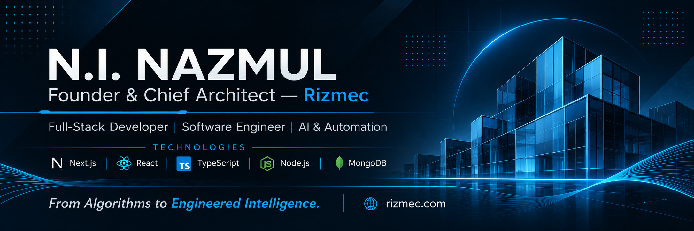

<!-- ===================== HEADER ===================== -->

  

<h1 align="center">Hi, I'm N.I. Nazmul 👋</h1>

<strong>Founder &amp; Chief Architect — <a href="https://www.rizmec.com">RIZMEC</a></strong>

  

  

  
  
  
  
  
  
  

  

---

## 👨‍💻 About Me

I'm **N.I. Nazmul**, a Full-Stack Developer and Senior Web Developer specializing in **Next.js, React, TypeScript, and the MERN stack**. I'm the Founder & Chief Architect of **[RIZMEC](https://www.rizmec.com)**, where I lead end-to-end development: system architecture, database design, secure API development, deployment, optimization, and ongoing product improvement.

My work spans CMS, CRM, LMS, ERP, e-commerce platforms, dashboards, and custom web applications, always with a focus on scalability, security, performance, and user experience.

Beyond code, I'm also a **professional voice-over & dubbing artist and spokesperson** working in Bengali, Hindi, and English.

- 💼 Founder & Chief Architect at **[RIZMEC](https://www.rizmec.com)** (Oct 2024 – Present)
- 💼 Senior Web Developer at **SA Creative Media** (Jun 2023 – Present)
- 🎓 Web Development Instructor at **Octal Technical Training Institute** (Nov 2026 – Present)
- 🧩 Backend architecture, REST API design, authentication & RBAC, and modern frontend with React and Next.js
- 🤖 AI-augmented engineering: using AI tooling for implementation, debugging, refactoring, research, and delivery
- 📍 Dhaka, Bangladesh

<table>
<tr>
<td valign="top" width="50%">

### 🚀 What I Do
- 🏗️ Architect and ship production web apps at RIZMEC (15+ delivered)
- 🔐 Build reusable RBAC and workflow modules
- ⚙️ Manage production infrastructure: Linux VPS, Nginx, PM2, CI/CD
- 🧑‍🏫 Teach web development: HTML, CSS, JavaScript, and project workflows

</td>
<td valign="top" width="50%">

### 🤝 Open to Collaborate On
- SaaS products & startups
- ERP / CRM / LMS / CMS platforms
- E-commerce systems
- Technical advisory & consulting

</td>
</tr>
</table>

---

## 🧱 Featured Projects

| Project | What it is | Stack |
| :--- | :--- | :--- |
| **[Daily Muktimarg](https://dailymuktimarg.com/)** | News & media CMS with dual Bengali calendar, homepage layout builder, and granular RBAC | Next.js 16, TypeScript, MongoDB, Clerk, TipTap |
| **[Grihinir Bari](https://grihinirbari.com/)** | E-commerce platform and admin dashboard with secure order management and COD delivery | Next.js 16, React 19, MongoDB, Clerk, UploadThing |
| **[Qorvan](https://www.houseofqorvan.com/)** | Storefront and admin system with variant selectors, inventory control, COD and coupons | Next.js, TypeScript, MongoDB, UploadThing |
| **[Hormuzan Foundation](https://hormuzanfoundation.org/)** | Community welfare and transparent-philanthropy platform with multi-locale support | Next.js, MongoDB, Clerk, TipTap |

More at **[rizmec.com/p/ninazmul](https://www.rizmec.com/p/ninazmul)**.

---

## 💻 Tech Stack

<b>Languages</b>

 

<b>Frontend</b>

 

<b>Backend & Databases</b>

 

<b>Cloud, DevOps & Tools</b>

 

<b>Design & Media</b>

 

---

## 🧭 Experience

| Role | Organization | Period |
| :--- | :--- | :--- |
| Web Development Instructor | Octal Technical Training Institute | Nov 2026 – Present |
| Founder & Chief Architect | RIZMEC | Oct 2024 – Present |
| Senior Web Developer | SA Creative Media | Jun 2023 – Present |
| Full-Stack Developer (Contract) | Academic Bridge | May 2025 – Apr 2026 |
| Full-Stack Developer (Internship) | IT Training BD | Jul 2024 – Sep 2024 |

**Highlights:** architected the AB Partner Portal, a multi-role ERP with RBAC, automated offer letters, and certificate generation (30% faster API responses); built an LMS from scratch with MERN + TypeScript (40% query optimization); built reusable RBAC and workflow modules that cut client onboarding time by 25%.

## 🎓 Education & Certifications

- Bangladesh Open University — Undergraduate Studies (ongoing)
- Data Structures and Algorithms — Phitron (2026)
- Software Engineer — HackerRank (2026)
- Problem Solving (Basic) — HackerRank (2025)

---

## ⚡ Philosophy

> Build systems that scale, interfaces that feel natural, and software that stays maintainable under pressure.

---

## 📬 Let's Work Together

I'm open to opportunities, consulting, and technical advisory engagements. Reach out directly or visit [RIZMEC](https://www.rizmec.com):

📧 [ninazmul@rizmec.com](mailto:ninazmul@rizmec.com) · 💬 [WhatsApp](https://wa.me/8801580845746) · ✈️ [Telegram](https://t.me/ninazmul) · 🎮 Discord: `n.i.nazmul`

  
  

  <i>Thanks for stopping by — let's build something great together.</i>

